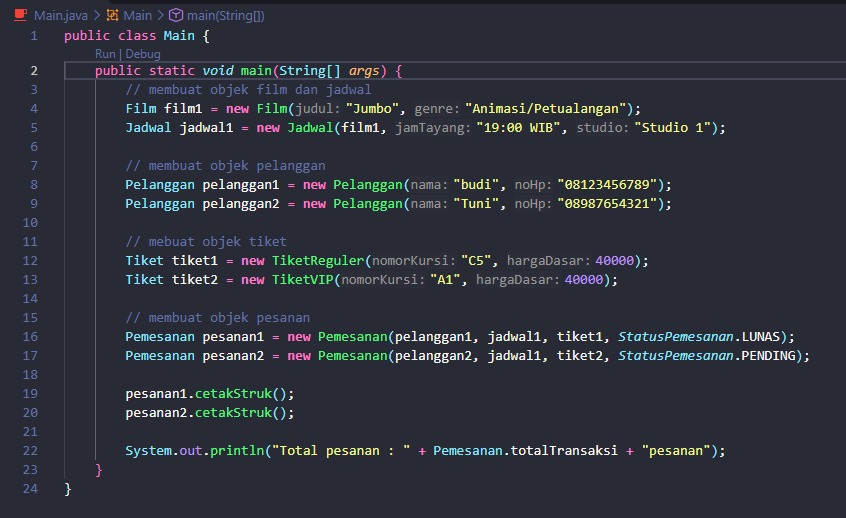
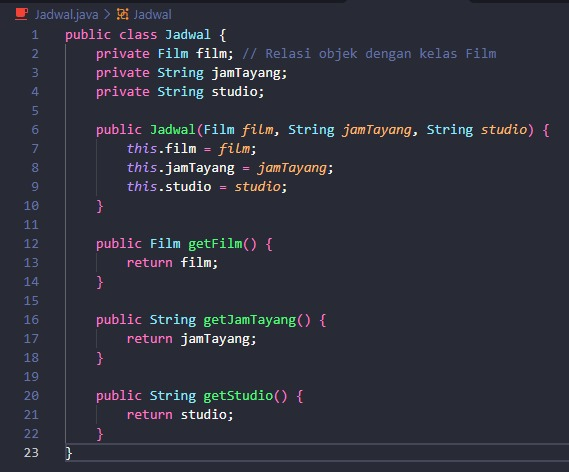
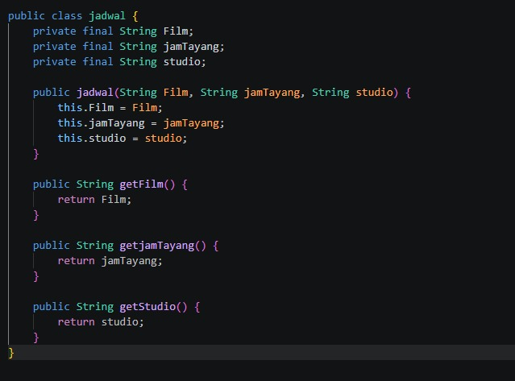
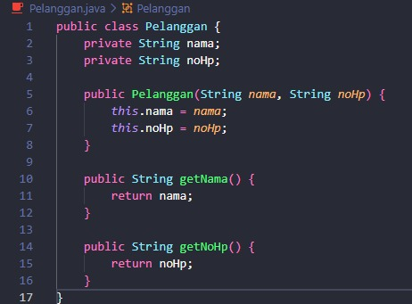
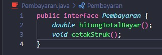
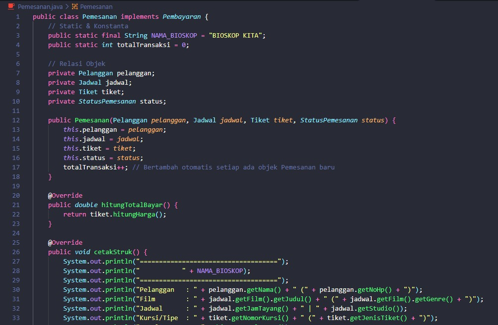
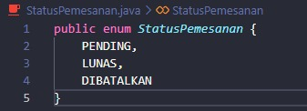
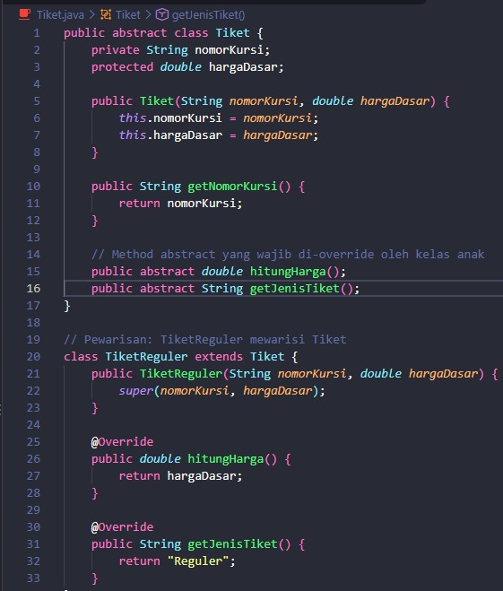
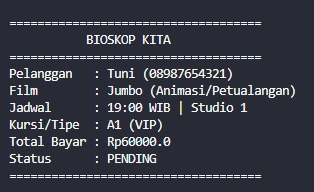

# LAPORAN UTS PRAKTIKUM PEMROGRAMAN BERBASIS OBJEK

| Informasi Proyek | Keterangan |
| :--- | :--- |
| **Mata Kuliah** | Pemrograman Berbasis Objek (PBO) |
| **Kelas** | A |
| **PJ** | [Alifian Revan Arnanta] |
| **Tema** | [Pemesanan Tiket Bioskop] |
| **Tanggal** | [22 Oktober 2026] |
| **Nama** | [ Ridho Sachlan ] |
| **NPM** | [ 4525210066 ] |

---

## Detail Pengerjaan & Anggota Kelompok

| Nama | NPM | Tugas / Fitur yang Dikerjakan |
| :--- | :--- | :--- |
| [Ridho Sachlan] | [4525210066] | [jadwal.java] |
| [Saka Laksmana Harimurti] | [4525210067] | [main.java] |
| [Satria Mahardika] | [4525210068] | [jadwal.java] |
| [Syabita Putri Safina] | [4525210072] | [tiket.java] |
| [Theofani Natanya Anari Hutabarat] | [4525210074] | [statuspemesanan.java] |
| [Uziel Askarillah Saputra] | [4525210075] | [film.java] |
| [Nur Wahyu Muhtiin Haniv] | [4525210078] | [film.java] |
| [IGede Ardhika Arimbawa Tangkas] | [4525210080] | [pembayaran.java] |
| [Muhammad Alfarel Prihadi] | [4525210083] | [pelanggan.java] |
| [ Sheraya Rasya Miftah Firdaus] | [4525210069] | [TIDAK HADIR] |

---

## Deskripsi Proyek
> [Pemesanan tiket dengan tipe file java dengan 8 fitur yaitu film.java, jadwal.java, main.java, pelanggan.java, pembayaran.java, pemesanan.java, statusPemesanan.java, dan tiket.java. Program ini menampilkan nama film, pemesanan tiket, pembayaran tiket, dan statusnya.]

**Daftar Fitur:**
1. [main.java]
2. [film.java]
3. [jadwal.java]
4. [pelanggan.java]
5. [pembayaran.java]
6. [pemesanan.java]
7. [statusPemesanan.java]
8. [tiket.java]

---

## 1. Implementasi Java

### 1.1. File: `main.java`
**Penjelasan Kode:**
> [Berisi tentang film dan juga jadwal penayangan lalu berisi objek pelanggan dan isi nama dan nomor telepon lalu ada objek tiket yang berisi tiket yang dipesan kemudian mengisi objek pesanan yang berisi pemesanan tiket dan status pembayaran dan mencetak struk.]

**Screenshot Kode:**

### 1.2. File: `film.java`
**Penjelasan Kode:**
> [Menggunakan class yang bersifat publik menyertakan judul dan juga genre dari film yang ditayangkan dari bioskop.]

**Screenshot Kode:**

### 1.3. File: `jadwal.java`
**Penjelasan Kode:**
> [Menggunakan class yang bersifat publik menampilkan jadwal film, jam tayang dan studio.]

**Screenshot Kode:**

### 1.4. File: `pelanggan.java`
**Penjelasan Kode:**
> [Menggunakan class yang bersifat publik menampilkan nama pelanggan dan nomor telepon]

**Screenshot Kode:**

### 1.5. File: `pembayaran.java`
**Penjelasan Kode:**
> [Menggunakan class yang bersifat publik mencetak struk dari pemesanan yang dilakukan]

**Screenshot Kode:**

### 1.6. File: `pemesanan.java`
**Penjelasan Kode:**
> [Class `pemesanan` berfungsi untuk mengelola transaksi tiket bioskop. Constructor menyimpan data pemesanan, `totalTransaksi` menghitung jumlah objek yang dibuat, `hitungtotalbayar()` menghitung harga tiket, sedangkan `cetakstruk()` menampilkan detail pemesanan dan pembayaran.]

**Screenshot Kode:**

## 1.7. File: `statusPemesanan.java`
**Penjelasan Kode:**
> [Menampilkan status pemesanan dengan tipe data enum.]

**Screenshot Kode:**

## 1.8. File: `tiket.java`
**Penjelasan Kode:**
> [Class `tiket` merupakan class abstrak yang menyimpan nomor kursi dan harga dasar, serta menentukan method untuk menghitung harga dan jenis tiket. `TiketReguler` menggunakan harga dasar, sedangkan `TiketVIP` menambahkan biaya Rp20.000. Kode ini menerapkan konsep inheritance, abstraction, dan polymorphism dalam Java.]

**Screenshot Kode:**

### Output
**Hasil Running Program (Java):**

---

## 3. Kesimpulan
> [Program ini adalah sistem pemesanan tiket bioskop sederhana. Film menyimpan judul dan genre, Jadwal menghubungkan film dengan jam tayang dan studio, Pelanggan menyimpan nama dan nomor HP, sedangkan Tiket (abstrak) diturunkan menjadi TiketReguler dan TiketVIP. StatusPemesanan berupa enum, dan Pemesanan menggabungkan semuanya untuk menghitung total bayar dan mencetak struk. Main membuat dua pesanan lalu mencetak struk dan total transaksinya. Konsep OOP yang diterapkan: enkapsulasi (atribut private dengan getter), pewarisan (TiketReguler extends Tiket), abstraksi (kelas abstrak Tiket dan interface Pembayaran), serta polimorfisme (variabel Tiket bisa berisi TiketReguler atau TiketVIP, dan hitungHarga() menyesuaikan jenisnya). Ada juga relasi antar objek (Jadwal memiliki Film, Pemesanan memiliki Pelanggan, Jadwal, dan Tiket) serta anggota static (NAMA_BIOSKOP dan totalTransaksi).]